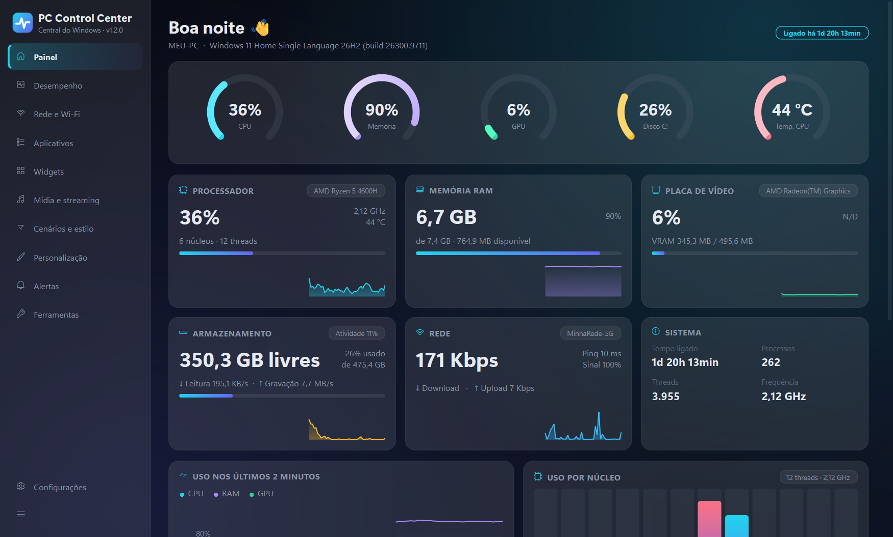
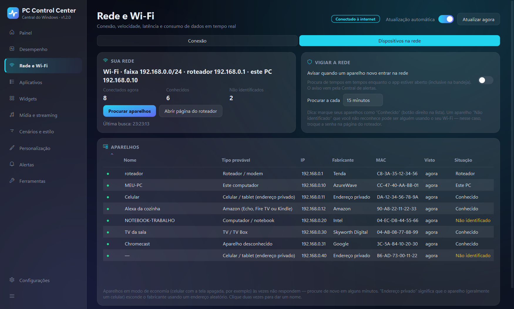
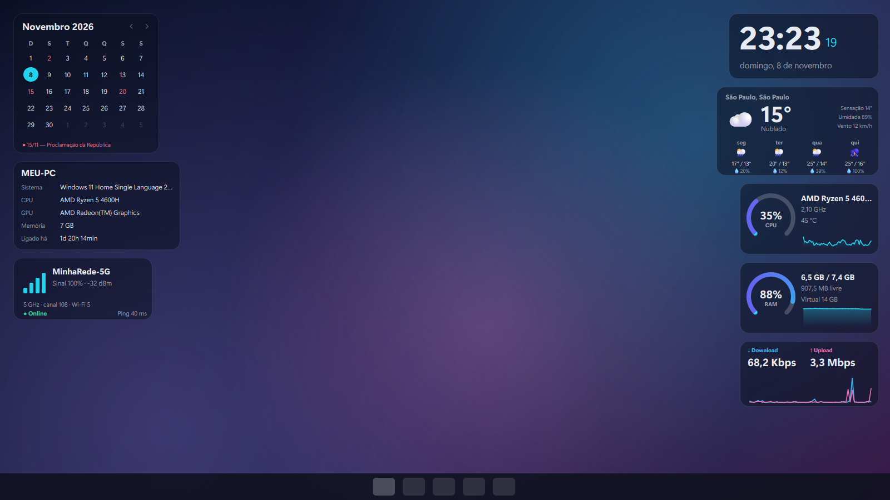
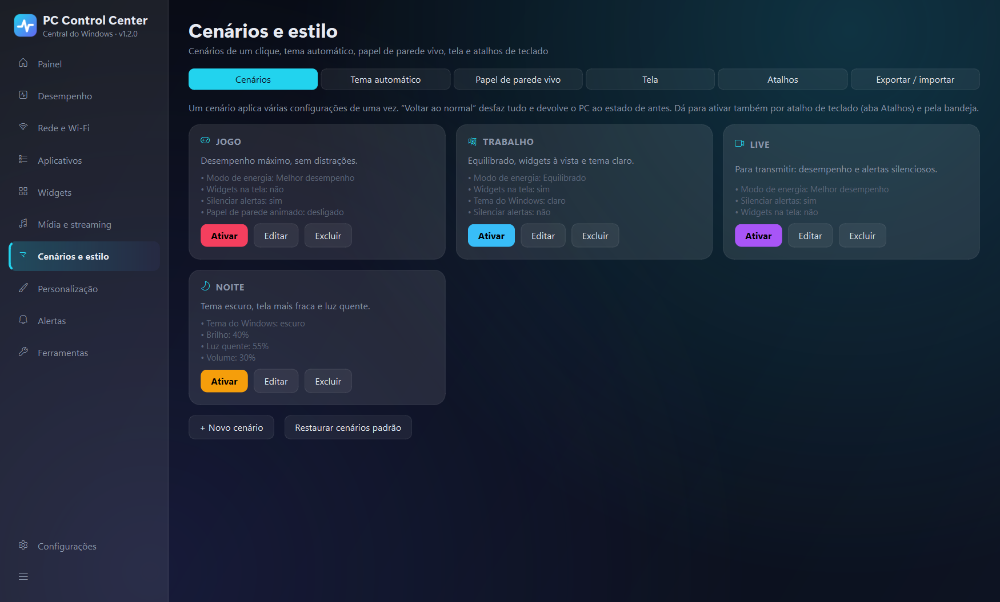
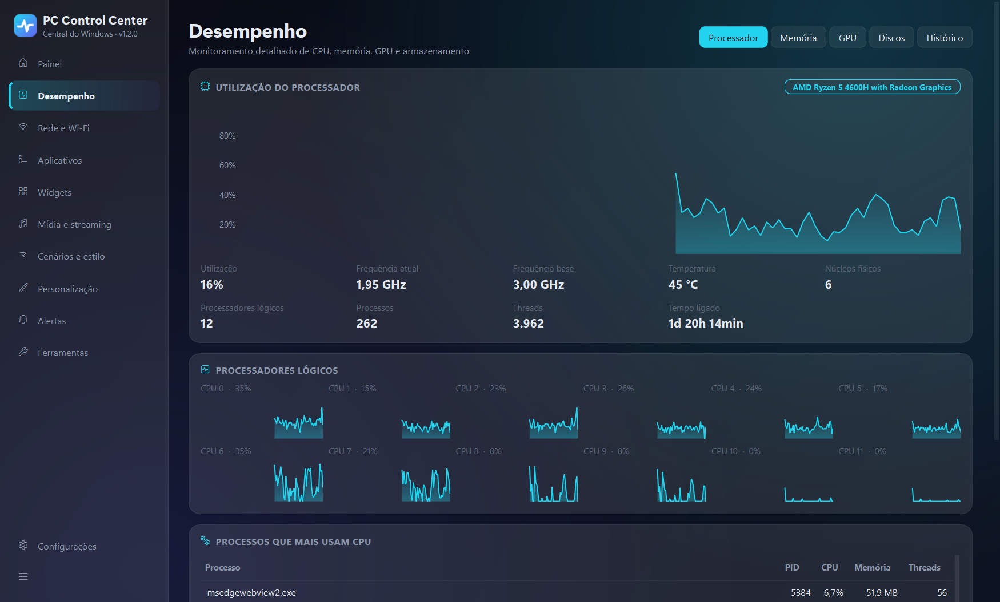

# PC Control Center

Central de monitoramento, otimização e personalização do Windows, com dados **reais** do
computador (nada simulado). Feito em Python + PySide6 (Qt 6), usando APIs nativas do Windows.


[](https://github.com/KawanVictor/PC-Control-Center/actions/workflows/ci.yml)



<table>
  <tr>
    <td width="50%"><br><sub><b>Rede:</b> aparelhos conectados, com fabricante, tipo provável e aviso de aparelho novo</sub></td>
    <td width="50%"><br><sub><b>Widgets</b> na área de trabalho: relógio, clima, CPU, RAM, rede, Wi-Fi...</sub></td>
  </tr>
  <tr>
    <td width="50%"><br><sub><b>Cenários</b> de um clique (Jogo, Trabalho, Live, Noite) com "voltar ao normal"</sub></td>
    <td width="50%"><br><sub><b>Desempenho:</b> CPU por núcleo, memória, GPU, discos e histórico</sub></td>
  </tr>
</table>

<sub>Capturas geradas em modo demonstração (`python -m build_tools.readme_shots`): nome do PC, rede
Wi-Fi e aparelhos são fictícios; CPU, memória e discos são leituras reais.</sub>

## Recursos

| Área | O que faz |
|---|---|
| **Painel e desempenho** | CPU (por núcleo), RAM, GPU, discos, temperaturas e processos em tempo real, com histórico |
| **Rede e Wi-Fi** | Sinal, ping, estabilidade, consumo de dados, teste de velocidade e **aparelhos conectados à rede** |
| **Aplicativos** | Programas instalados (desinstalador oficial), processos e itens de inicialização com desfazer |
| **Widgets** | 20 widgets de área de trabalho (relógio, clima, CPU, player, visualizador de áudio, FPS...) com perfis |
| **Personalização** | Tema, cor de destaque, papel de parede, barra de tarefas, atalhos, com histórico desfazível |
| **Mídia e streaming** | Volume por app, troca de saída de som, visualizador, OBS (obs-websocket), YouTube e contador de FPS |
| **Cenários e estilo** | Cenários de um clique, tema automático pelo sol, papel de parede dinâmico/animado, brilho, luz quente e atalhos globais |
| **Alertas** | Alertas inteligentes, notificações que respeitam jogos/tela cheia, diagnóstico e relatórios HTML/CSV |

Segurança em primeiro lugar: sem administrador por padrão, backup antes de mexer no Registro,
confirmação nas ações críticas e registro de tudo o que é feito. Veja [docs/SECURITY.md](docs/SECURITY.md).

## Instalar (usuário final)

1. Baixe o `PCControlCenter-Setup-<versão>.exe` na página
   [**Releases**](https://github.com/KawanVictor/PC-Control-Center/releases/latest) do repositório (ou gere com o
   `build.ps1`, que salva em `release\`). **Não precisa de administrador**: o app é instalado só para
   o seu usuário em `%LOCALAPPDATA%\Programs\PC Control Center`.
2. Escolha se quer atalho na área de trabalho e se quer iniciar com o Windows.
3. Para desinstalar: **Configurações → Aplicativos → PC Control Center → Desinstalar**. Seus dados
   são mantidos, a menos que você confirme apagá-los.

Sem instalar: use o `PCControlCenter-<versão>-portatil.zip` e abra `PC Control Center.exe`.
Para atualizar, basta instalar a versão nova por cima: configurações, histórico e widgets são mantidos.

> O Windows SmartScreen pode avisar "Editor desconhecido" porque o executável não tem assinatura
> digital (certificado pago). Clique em *Mais informações → Executar assim mesmo*.

## Desenvolvimento

### Estrutura

```
├── main.py                 ponto de entrada (--minimized, --debug, --selftest)
├── pccc/                   código do app
│   ├── core/               configurações, banco SQLite, logs, segurança, Registro com backup
│   ├── monitoring/         CPU, memória, GPU, discos, temperaturas, processos
│   ├── network/            Wi-Fi, interfaces, ping, teste de velocidade, aparelhos na rede
│   ├── apps/               programas instalados, inicialização, processos
│   ├── widgets/            widgets da área de trabalho
│   ├── personalization/    personalização do Windows, cenários, tema automático, atalhos
│   ├── media/              áudio, visualizador, OBS, YouTube, FPS
│   ├── automation/         alertas, notificações, diagnóstico, relatórios
│   └── ui/                 janela, páginas e componentes
├── tests/                  baterias de teste (tests.run_all executa todas)
├── config/                 configurações padrão
├── assets/                 ícone
├── docs/                   arquitetura e segurança
├── build.ps1 · pccc.spec · installer.iss · build_tools/   geração do .EXE e do instalador
└── setup.ps1 · run.bat     ambiente de desenvolvimento
```

Detalhes de cada módulo em [docs/ARCHITECTURE.md](docs/ARCHITECTURE.md). Histórico de versões em
[CHANGELOG.md](CHANGELOG.md).

### Requisitos

- Windows 10 (build 1903+) ou Windows 11
- Python 3.11+ (o `setup.ps1` instala o 3.12 automaticamente via winget, se faltar)

### Instalação do ambiente

```powershell
powershell -ExecutionPolicy Bypass -File setup.ps1
```

O ambiente virtual é criado em `%LOCALAPPDATA%\PCControlCenter\venv` (fora do OneDrive, que
bloqueia arquivos durante a instalação de pacotes).

Instalação manual equivalente:

```powershell
python -m venv "$env:LOCALAPPDATA\PCControlCenter\venv"
& "$env:LOCALAPPDATA\PCControlCenter\venv\Scripts\python.exe" -m pip install -r requirements.lock
```

`requirements.lock` fixa a versão exata de cada pacote (as mesmas usadas no .exe publicado), para o
build ser reproduzível. `requirements.txt` guarda só as faixas de versão aceitas.

### Execução

| Comando | Efeito |
|---|---|
| `run.bat` | abre a janela (sem console) |
| `run.bat debug` | abre com log detalhado no console |
| `run.bat --minimized` | inicia direto na bandeja do sistema |
| `python main.py [--minimized] [--debug]` | execução direta |
| `python main.py --selftest` | autoteste sem interface (~10 s), resultado em `logs\selftest.txt` |

As mesmas opções valem para o `PC Control Center.exe`.

Só uma instância roda por vez: abrir de novo apenas traz a janela existente para frente.

## Iniciar com o Windows (todas as versões)

**Configurações → Inicialização e bandeja → Iniciar com o Windows.**

Isso grava o valor `PCControlCenter` em
`HKCU\Software\Microsoft\Windows\CurrentVersion\Run` (sem administrador). O app abre
minimizado na bandeja. Para desfazer, desligue a opção ou desative em
Gerenciador de Tarefas → Aplicativos de inicialização.

Se a opção estava ligada na versão em Python, ao abrir o .EXE o caminho é atualizado sozinho.

## Testes

O [CI](.github/workflows/ci.yml) roda a cada push, num Windows limpo do GitHub, as baterias que não
dependem do hardware: segurança, alertas e relatórios (relógio simulado), mídia e cenários (OBS
simulado) e o desenho dos widgets fora da tela. As verificações que precisam de placa de som, rede
local ou área de trabalho real aparecem como PULADO lá e rodam no `tests.run_all` local.

```powershell
$py = "$env:LOCALAPPDATA\PCControlCenter\venv\Scripts\python.exe"
& $py -m tests.run_all             # TODAS as baterias com resumo (~2 min)
& $py -m tests.run_all --full      # + janelas reais dos widgets e teste de velocidade
& $py -m tests.run_all --exe "$env:LOCALAPPDATA\PCControlCenter\build\dist\PC Control Center\PC Control Center.exe"
& $py -m tests.test_security       # 17 verificações de segurança (ver docs/SECURITY.md)
& $py -m tests.test_collector      # coleta real por 4 s e valida os dados
& $py -m tests.test_network        # Wi-Fi, interfaces, ping e consumo (6 s)
& $py -m tests.test_network --speed  # + teste de velocidade real (~16 s, 100–400 MB)
& $py -m tests.test_ping           # perda de pacotes e nota de estabilidade
& $py -m tests.test_apps           # inicialização/desfazer, encerrar processo, desinstalação (fictícios)
& $py -m tests.test_widgets        # gerenciador/perfis (sem tela) + desenho dos 20 widgets
& $py -m tests.test_widgets --render-only shots   # imagens dos 20 widgets com fontes reais
& $py -m tests.test_widget_windows # janelas reais: arrastar, encaixar, redimensionar (layout temporário)
& $py -m tests.test_personalization  # aplica e DESFAZ cada tipo de alteração, conferindo o Registro
& $py -m tests.test_automation     # motor de alertas (relógio simulado), relatórios e sugestões
& $py -m tests.test_media_scenes   # OBS (servidor simulado), FPS, YouTube, cenários, atalhos, temas
& $py -m tests.ui_smoke shots       # abre a interface, percorre as páginas e salva capturas
```

## Gerar o executável (.EXE)

```powershell
powershell -ExecutionPolicy Bypass -File build.ps1
```

O script, em ordem:

1. Instala o PyInstaller no ambiente, se faltar.
2. Roda os testes de segurança. Se algum falhar, o build para.
3. Gera o ícone (`assets\app.ico`, 16 a 256 px) e os metadados de versão (Propriedades → Detalhes).
4. Empacota com o PyInstaller usando o `pccc.spec` (formato pasta, sem console, manifesto
   `asInvoker`, sem UPX).
5. Roda o **`--selftest` no .EXE gerado** e só continua se tudo passar.
6. Gera `release\PCControlCenter-<versão>-portatil.zip` e, com o **Inno Setup**, o instalador
   `release\PCControlCenter-Setup-<versão>.exe`.

| Opção | Efeito |
|---|---|
| `-SkipTests` | pula os testes de segurança (o autoteste do .EXE sempre roda) |
| `-NoInstaller` | gera só o .zip portátil |

O Inno Setup é instalado sem administrador com:
`winget install JRSoftware.InnoSetup --scope user`. Os arquivos intermediários ficam em
`%LOCALAPPDATA%\PCControlCenter\build` (fora do OneDrive) e levam ~1–3 min para gerar.

## Onde ficam os dados

`%APPDATA%\PCControlCenter\`

- `settings.json` — configurações
- `history.db` — histórico (SQLite, médias por minuto, retenção configurável)
- `logs\app.log` — log técnico
- `logs\operations.log` — registro de auditoria das ações executadas

## Temperaturas

O Windows não oferece uma API padrão de temperatura de CPU. O app tenta, nesta ordem:

1. **LibreHardwareMonitor** (ou OpenHardwareMonitor) aberto → CPU, GPU e discos com precisão.
2. **Zona térmica ACPI** (sem administrador) → em notebooks costuma refletir a CPU.
3. **Temperatura de discos** → exige executar como administrador.

Quando nenhuma fonte está disponível, o app mostra **N/D** com a explicação, em vez de inventar um valor.

## Rede e Wi-Fi

- **Nome da rede (SSID):** no Windows 11 24H2 ou mais recente, exige a opção *Configurações →
  Privacidade e segurança → Localização → Permitir que aplicativos da área de trabalho acessem sua
  localização*. Sem ela, o app avisa e oferece um botão para abrir essa tela. O sinal continua visível.
- **Ping contínuo:** 1 pacote ICMP por segundo para o servidor de referência (padrão `1.1.1.1`) e
  para o roteador. Pode ser desligado ou trocado em Configurações → Rede.
- **Consumo de dados:** contabilizado enquanto o app está aberto, inclusive na bandeja. Guardado
  por dia por 13 meses.
- **Teste de velocidade:** usa os servidores públicos da Cloudflare (o mais próximo; em São Paulo
  é o GRU). Só roda quando você clica em *Iniciar teste*.
- **Dispositivos na rede** (aba da página Rede e Wi-Fi): lista os aparelhos conectados à sua rede
  (celulares, TVs, consoles, PCs, impressoras, Alexa...) com nome, tipo provável, IP, fabricante,
  MAC e quando foram vistos. A busca leva ~10 s e não precisa de administrador.
  - **Como descobre:** pergunta (ARP) quem está em cada endereço da sua faixa de rede e tenta o nome
    pelo roteador (DNS), NetBIOS e UPnP. O fabricante vem pela lista pública de fabricantes de placas
    de rede (IEEE, via Wireshark), baixada uma vez (~3 MB). Não há varredura de portas.
  - **Celulares** costumam usar "endereço privado" (MAC aleatório), então o fabricante não aparece,
    mas o tipo provável sim.
  - **Organize:** clique duas vezes para dar um nome e use o botão direito para *Marcar como
    conhecido*, copiar IP/MAC ou abrir no navegador. Aparelhos que saíram ficam como "fora da rede".
    Cada rede (casa, trabalho) tem a própria lista.
  - **Vigiar a rede** (opcional): procura a cada 5–60 min e avisa na Central de alertas quando
    um aparelho novo entrar. Se não reconhecer o aparelho, use *Abrir página do roteador* para trocar a
    senha do Wi-Fi.

## Aplicativos e processos

- **Desinstalar** sempre executa o desinstalador oficial do programa (`UninstallString`),
  `msiexec /X{GUID}` para pacotes MSI ou `Remove-AppxPackage` para apps da Store. Antes, mostra o
  comando exato. O PC Control Center **não apaga arquivos nem chaves do Registro** por conta própria.
- **Encerrar processos:** processos essenciais do Windows (csrss, lsass, svchost, dwm, winlogon…)
  são bloqueados. Os demais pedem confirmação. Nada é encerrado automaticamente.
- **Inicialização:** ativar/desativar usa o mesmo mecanismo do Gerenciador de Tarefas
  (`StartupApproved`). A entrada original nunca é apagada, todo valor alterado ganha backup no SQLite
  e o botão *Desfazer última alteração* restaura o valor anterior. Itens de "todos os usuários"
  exigem administrador.

## Widgets da área de trabalho

20 widgets: relógio, calendário (com feriados nacionais), clima, CPU, RAM, GPU, temperaturas,
Wi-Fi, download/upload, armazenamento, player de música, informações do sistema, bateria,
atalhos, processos, visualizador de áudio, volume e mixer, OBS Studio, YouTube e contador de FPS.

- **Adicionar:** página *Widgets* → galeria → *Adicionar* (ou *Aplicar layout sugerido*).
- **Mover:** arraste. O widget encaixa nas bordas da tela e nos outros widgets.
- **Redimensionar:** canto inferior direito ou **Ctrl + roda do mouse**. O desenho é vetorial,
  então fica nítido em qualquer tamanho.
- **Configurar:** clique duplo ou botão direito → *Configurar*. Dá para mudar cores, transparência,
  tamanho, fonte, intervalo de atualização e camada (atrás das janelas / normal / sempre visível),
  além das opções de cada tipo (cidade do clima, formato 24 h, lista de atalhos...).
- **Perfis:** cada perfil é um layout completo (ex.: "Trabalho", "Jogos"). Ficam salvos em
  `%APPDATA%\PCControlCenter\widgets.json`.
- **Bandeja:** *Ocultar/Mostrar widgets*. Os widgets também abrem junto com o app (opção
  *Mostrar widgets ao iniciar*).
- **Clima:** dados da [Open-Meteo](https://open-meteo.com), gratuita e sem cadastro, atualizados a cada 15 min.
- **Player:** usa os controles de mídia do Windows (os mesmos do painel de volume). Funciona com
  Spotify, YouTube no navegador, Media Player etc.

## Personalização do Windows

Abas: **Aparência** (modo claro/escuro, cor de destaque, transparência, animações), **Papel de
parede** (imagens do Windows ou suas, com ajuste), **Temas** instalados, **Barra de tarefas**
(alinhamento, pesquisa, botões, segundos no relógio, "Finalizar tarefa", ocultar automaticamente),
**Área de trabalho** (ícones, extensões, arquivos ocultos, menu de contexto clássico, inicialização),
**Atalhos** (criar atalhos para programas, pastas e sites, ou usar modelos prontos), **Apps padrão** e
**Histórico**.

- **Tudo pode ser desfeito:** cada alteração entra no *Histórico*. Valores do Registro ganham backup
  antes de mudar. Se a mudança criou chaves novas, *Desfazer* também as remove.
- **Papel de parede:** a imagem anterior é copiada para `%APPDATA%\PCControlCenter\wallpapers`
  antes da troca.
- **Apps padrão:** o Windows protege essas associações contra programas externos. O app mostra qual
  é o padrão atual de cada tipo, e a troca é feita na tela oficial do Windows.
- Alguns itens (menu clássico) só aparecem depois de **reiniciar o Explorer**. O app mostra um botão
  para isso.

## Alertas e automações

- **Alertas:** CPU alta, RAM quase cheia, memória virtual no limite, temperatura de CPU/GPU, disco
  quase cheio, queda de internet/Wi-Fi (e aviso quando volta), programa com consumo excessivo de
  CPU ou RAM e bateria fraca. Cada regra tem **limite**, **duração mínima** (picos curtos não
  alertam) e **intervalo entre repetições**, tudo configurável em *Alertas → Regras*.
- **Notificações do Windows:** pela bandeja; clicar abre a Central. Não aparecem durante jogos ou
  vídeos em tela cheia, apresentações, "Não incomodar" do Windows ou no horário de silêncio que
  você definir. Mesmo assim, ficam registradas na Central. Alertas **críticos** (temperatura
  perigosa) aparecem sempre.
- **Diagnóstico:** mostra o gargalo principal da última hora e sugestões baseadas nos seus dados,
  cada uma com um botão para a ferramenta certa. Também reúne as ferramentas de manutenção oficiais
  do Windows. Por segurança, não há "limpeza de RAM" nem encerramento automático de processos.
- **Relatórios:** 24 h, 7 dias ou 30 dias. Exportam em **HTML** (com gráficos, abre no navegador)
  ou **CSV** (Excel), salvos em `Documentos\PC Control Center\Relatórios`. Um relatório semanal
  automático é gerado e avisado (dá para desligar).

## Mídia e streaming

- **Áudio:** troca a saída de som (alto-falantes, fone, monitor HDMI) e ajusta o volume geral e o
  **volume de cada aplicativo**, com nível em tempo real, como o Mixer de Volume do Windows.
- **Visualizador:** espectro do som que está tocando, na página ou como widget na área de trabalho.
  Ele lê uma cópia do som que vai para os alto-falantes: nada é gravado e o microfone não é usado.
- **OBS Studio:** pelo obs-websocket (OBS 28+, *Ferramentas → Configurações do servidor
  WebSocket*). Mostra se está ao vivo ou gravando, o tempo, a cena, o bitrate, os quadros perdidos e
  a CPU do OBS. Troca de cena e inicia/para a gravação e a transmissão (a transmissão pede
  confirmação). A senha fica criptografada pelo Windows (DPAPI).
- **YouTube:** cole o link do canal (`youtube.com/@nome`) e veja os vídeos novos, com aviso quando
  sair um vídeo. Usa o feed público do YouTube, sem login.
- **Contador de FPS:** usa o **PresentMon**, ferramenta oficial e gratuita da Intel. O app baixa o
  PresentMon só quando você pede e confere a assinatura digital da Intel antes de cada uso. O Windows
  só libera a medição de quadros para administradores, então **ligar o contador mostra um aviso do
  UAC**. O FPS aparece na página e no widget "Contador de FPS". Use a camada *Sempre visível* para ele
  ficar por cima de jogos em janela ou em tela cheia sem bordas.
- **Widgets novos:** Visualizador de áudio, Volume e mixer, OBS Studio, YouTube e Contador de FPS
  (20 widgets no total).

## Cenários e estilo

- **Cenários** (Jogo, Trabalho, Live, Noite, ou os seus): um clique aplica de uma vez o modo de
  energia, o tema e a cor do Windows, o papel de parede, o perfil de widgets, a saída e o volume do
  som, o brilho, a luz quente, os alertas silenciados, a cena do OBS, o contador de FPS e os
  programas para abrir. **Voltar ao normal** devolve tudo ao estado de antes do primeiro cenário,
  mesmo que você tenha trocado de cenário no meio. Também ativa pela bandeja (*Cenários*) e por
  atalho de teclado.
- **Tema automático:** claro de dia e escuro à noite, pelo nascer/pôr do sol da sua cidade
  (calculado no próprio PC) ou em horários fixos.
- **Papel de parede dinâmico:** imagem do dia do Bing, foto astronômica do dia da NASA, apresentação
  de slides de uma pasta ou uma imagem por período do dia.
- **Papel de parede animado:** vídeo (MP4, WEBM, MKV...) ou GIF atrás dos ícones, sem som. Pausa
  sozinho em jogos e vídeos em tela cheia, com janela maximizada e na bateria.
- **Tela:** brilho da tela do notebook e de monitores com DDC/CI. **Luz quente** ajustável, que
  pode ligar sozinha ao anoitecer. Se o app fechar, a tela volta ao normal na hora.
- **Atalhos de teclado globais:** por exemplo, Ctrl+Alt+J ativa o cenário Jogo, Ctrl+Alt+N volta ao
  normal e Ctrl+Alt+W mostra ou oculta os widgets. Também há atalhos de volume, música, papel de
  parede animado, FPS, gravação do OBS e luz quente. Se a combinação já pertence a outro programa, o
  app avisa e não a "rouba".
- **Exportar/importar:** salva o visual completo (aparência, widgets, cenários, atalhos, tema e cor do
  Windows e papel de parede) num arquivo `.pcctema`. Na importação, você vê o conteúdo e escolhe as
  partes. Programas que o arquivo mandaria abrir são listados e **removidos por padrão**.

Tudo o que muda no Windows (tema, cor, papel de parede) entra no *Histórico* de personalização e
pode ser desfeito.

## Segurança

Cada requisito de segurança, onde ele é aplicado no código e qual teste o confere estão em
[docs/SECURITY.md](docs/SECURITY.md). Resumo:

- O app abre sem administrador e só pede elevação quando você clica em uma ação que exige.
- Toda ação que altera algo pede confirmação, mostra o comando ou arquivo exato e fica registrada.
- O Registro só é alterado com backup e tudo pode ser desfeito.
- O app só apaga atalhos que ele mesmo criou, nunca em pastas do sistema.
- Ele não mexe em serviços nem limpa a RAM à força, e não encerra nenhum processo automaticamente.
- Arquivos de configuração ou banco de dados danificados são guardados e recriados, sem travar o app.

Mais detalhes em [docs/ARCHITECTURE.md](docs/ARCHITECTURE.md).

## Licença

Distribuído sob a licença MIT. Veja [LICENSE](LICENSE).

